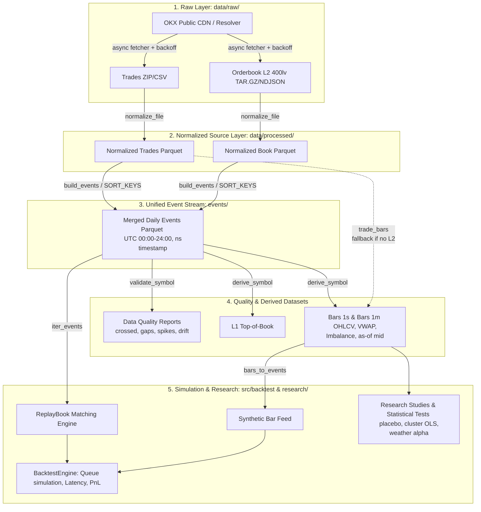

# Backtest Strat: High-Performance Crypto Market Data & Simulation Platform

Детерминированная исследовательская и торговая платформа для работы с высокочастотными и среднечастотными криптовалютными данными (сделки и глубокий L2-стакан биржи OKX).

Платформа объединяет полный цикл квант-разработки: от отказоустойчивой загрузки гигабайтных сырых архивов биржи до построения производных датасетов (L1, секундные/минутные бары), проверки качества данных, микроструктурного симулятора биржи (orderbook matching engine) и статистического арбитража.

---

## 1. Архитектура слоев данных (Data Pipeline Layers)

Все данные проходят через строго стандартизированные слои с сохранением в партиционированный Apache Parquet:



1. **`Raw` (`data/raw/<exchange>/<symbol>/<data_type>/`):** Неизменяемые архивы с биржи.
2. **`Normalized` (`data/processed/.../<data_type>/year=YYYY/month=MM/`):** Промежуточный Parquet по схеме [`EVENT_SCHEMA`](file:///Users/kyle/main/py_files/backtest_strat/docs/normalization.md).
3. **`Events` (`data/processed/.../events/year=YYYY/month=MM/<date>.parquet`):** Объединенный суточный поток событий по шкале UTC `[00:00:00, 24:00:00)`, детерминированно отсортированный по `(ts, is_book, msg_id, level)`.
4. **`Derived` (`data/processed/.../{l1, bars_1s, bars_1m}/`):** Производные витрины (L1 вершина книги, 1s и 1m бары с as-of котировками).
5. **`Simulation & Research`:** Симулятор исполнения рыночных и лимитных ордеров ([`BacktestEngine`](file:///Users/kyle/main/py_files/backtest_strat/docs/backtest.md)) и инструменты статистического анализа ([`src/research`](file:///Users/kyle/main/py_files/backtest_strat/docs/research_workflow.md)).

---

## 2. Быстрый старт (Quick Start)

Для запуска полного цикла достаточно 3 команд:

### Шаг 1: Скачать и собрать данные
Загрузить сделки и стакан по паре `BTC-USDT` за первую неделю 2024 года и собрать полный поток событий:
```bash
python -m src.cli --exchange okx --symbol BTC-USDT --mode backfill --start 2024-01-01 --end 2024-01-07 --stage all
```

### Шаг 2: Проверить качество данных
Выполнить потоковую валидацию собранных событий (проверка перевернутого стакана, гэпов, рассинхронизации цен и пропущенных дней):
```bash
python -m src.cli --exchange okx --symbol BTC-USDT --stage validate --start 2024-01-01 --end 2024-01-07
```

### Шаг 3: Запустить бэктест стратегии
Прогнать пример HFT-стратегии маркет-мейкинга на реальных исторических событиях стакана:
```bash
python scripts/run_backtest.py \
  --strategy src.backtest.examples:TouchMarketMaker \
  --param size=0.01 \
  --symbol BTC-USDT \
  --start 2024-01-01 \
  --end 2024-01-01 \
  --tick 0.1 \
  --lot 0.00000001
```

---

## 3. Web UI и Мониторинг

Платформа включает веб-дашборд на Streamlit и бэкенд на FastAPI с поддержкой фоновых задач (SQLite) и мониторингом ночного крона:

```bash
# Запуск API-сервера (порт 8000)
.venv/bin/uvicorn src.api.app:app --host 0.0.0.0 --port 8000 &

# Запуск Streamlit дашборда (порт 8501)
.venv/bin/streamlit run src/ui/dashboard.py --server.port 8501
```

В дашборде доступны:
- **Задачи:** мониторинг фоновых процессов сборки данных в реальном времени.
- **Покрытие данных:** матрица наличия сырых архивов и готовых Parquet-файлов по дням.
- **Качество данных:** статус проверок каждого торгового дня (счетчики OK/WARN/FAIL, примеры аномалий).
- **Расписание:** управление ночным регулярным сбором данных.
- **Логи:** фильтрация и поиск по суточным журналам.

---

## 4. Карта каталогов (Directory Structure)

```text
backtest_strat/
├── config/                     # Конфигурация планировщика (schedule.json)
├── data/                       # Локальное хранилище данных (в .gitignore)
│   ├── raw/                    # 1. Сырые ZIP и TAR.GZ архивы бирж
│   └── processed/              # 2-4. Нормализованный Parquet (events, l1, bars_1s, bars_1m)
├── docs/                       # Техническая документация подсистем
│   ├── README.md               # Оглавление документации и протокол сверки
│   ├── backtest.md             # Архитектура бэктестера и модели исполнения
│   ├── cli.md                  # Справка по консольному интерфейсу
│   ├── data_quality.md         # Система контроля качества данных
│   ├── derived_datasets.md     # Производные датасеты (L1, бары)
│   ├── ingestion.md            # Загрузчики данных с бирж
│   ├── normalization.md        # Нормализация и схема EVENT_SCHEMA
│   ├── okx_historical_data.md  # Спецификация данных OKX
│   ├── operations.md           # Эксплуатация, планировщик и логирование
│   ├── research_workflow.md    # Исследовательский воркфлоу и Point-in-Time
│   └── web_ui.md               # Web UI и спецификация HTTP API
├── logs/                       # Централизованные суточные логи (pipeline-YYYY-MM-DD.log)
├── research/                   # Исследовательские проекты и эксперименты
│   ├── template/               # Шаблон исследования с предрегистрацией
│   └── exp01_seasonal_weather_liquidity/ # Исследование сезонности и ликвидности
├── scripts/                    # Консольные утилиты запуска бэктестов
│   └── run_backtest.py         # Запуск стратегий на событиях
├── src/                        # Исходный код платформы
│   ├── api/                    # FastAPI бэкенд и SQLite очередь задач
│   ├── backtest/               # Движок бэктеста (ReplayBook, Engine, Portfolio)
│   ├── derived/                # Сборка L1 и баров (в т.ч. trade_bars)
│   ├── external/               # Внешние источники (Open-Meteo weather API)
│   ├── fetchers/               # Клиенты бирж (OkxFetcher)
│   ├── normalizers/            # Парсеры архивов и нормализаторы схем
│   ├── research/               # Библиотека квант-исследований (stats, evaluate, bars)
│   ├── storage/                # Parquet writer/reader, манифесты, замки
│   ├── ui/                     # Streamlit дашборд и мониторы
│   ├── utils/                  # Даты, логирование, retry, sync-обертки
│   ├── validation/             # Валидаторы стакана и сделок
│   ├── cli.py                  # Главная консольная точка входа
│   ├── pipeline.py             # Оркестратор этапов пайплайна
│   └── scheduler.py            # Ночной планировщик
├── tests/                      # Зеркальный тестовый набор (pytest)
├── ROADMAP.md                  # Статус реализации и дальнейшие планы
└── requirements.txt            # Зависимости Python
```

---

## 5. Дополнительные ссылки

* [**Оглавление документации (`docs/README.md`)**](file:///Users/kyle/main/py_files/backtest_strat/docs/README.md) — детальные описания каждого модуля платформы и журнал сверки.
* [**Дорожная карта проекта (`ROADMAP.md`)**](file:///Users/kyle/main/py_files/backtest_strat/ROADMAP.md) — перечень завершенных и запланированных фаз развития.
* [**Шаблон исследования (`research/template/`)**](file:///Users/kyle/main/py_files/backtest_strat/research/template/) — правила формулировки гипотез, предрегистрация и структура альфа-исследований.