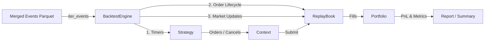

# Архитектура бэктестера: Event-Driven Simulation Core

Модуль `src/backtest` представляет собой высокопроизводительный, детерминированный, однопоточный симулятор для HFT и алгоритмических стратегий. Симулятор воспроизводит исторический поток событий из слоя `data/processed/<exchange>/<symbol>/events/` без использования сети и внешних зависимостей.

---

## 1. Общая архитектура



* **[`ReplayBook`](file:///Users/kyle/main/py_files/backtest_strat/src/backtest/book.py):** Восстановленная книга заявок L2 и локальный матчинг ордеров стратегии.
* **[`BacktestEngine`](file:///Users/kyle/main/py_files/backtest_strat/src/backtest/engine.py):** Главный цикл обработки очереди событий, доставка рыночных обновлений и таймеров.
* **[`Portfolio`](file:///Users/kyle/main/py_files/backtest_strat/src/backtest/portfolio.py):** Учет открытой позиции, средней цены входа, комиссий, реализованного и нереализованного PnL.
* **[`Context`](file:///Users/kyle/main/py_files/backtest_strat/src/backtest/strategy.py):** Изолированный интерфейс стратегии для запроса котировок и отправки торговых приказов.

---

## 2. Порядок обработки событий во времени

Для каждого события с временной меткой $t$ движок строго соблюдает следующий детерминированный порядок:

1. **Таймеры стратегии:** Обрабатываются все периодические таймеры, чье время $\le t$. Стратегия видит состояние стакана, актуальное непосредственно перед $t$.
2. **Активация и отмена ордеров:** Все ордера с $\text{active\_ts} \le t$ и отмены с $\text{effective\_ts} \le t$ применяются к текущей книге.
3. **Рыночное событие:**
   - **Сообщение стакана (`BOOK_SNAPSHOT` или `BOOK_UPDATE`):** Применяется целиком (все уровни одного пакета `msg_id`). Если книга смещается сквозь наш пассивный ордер, он немедленно исполняется как maker.
   - **Сделка (`TRADE`):** Сначала проверяются наши пассивные ордера на противоположной стороне. Объем сделки съедает очередь перед нами (`queue_ahead`) и затем исполняет наш ордер. После этого сделка отдается в колбэк `on_trade`.
4. **Колбэк стратегии:** Вызывается `on_book` или `on_trade`. Стратегия принимает решение и может выставить новые ордера.

---

## 3. Модель исполнения и отличия от `hft_sim`

Ядро симулятора перенесено и существенно доработано по сравнению с базовым `hft_sim`:

| Характеристика | Базовый `hft_sim` | Наш бэктестер |
| :--- | :--- | :--- |
| **Единицы времени** | Микросекунды (float / int) | Наносекунды (`int64`, как в `EVENT_SCHEMA`) |
| **Задержка отмены** | Мгновенно (`now`) | Моделируется с задержкой $\text{order\_latency}$ |
| **Съеденная ликвидность** | Не учитывалась (можно было взять больше доступного объема) | Учитывается в `_taken`: повторные агрессивные ордера не могут дважды забрать один объем до нового апдейта уровня |
| **Очередь (Queue-Ahead)** | Фиксировалась в момент выставления | Ограничена сверху объемом уровня: отмены перед нами режут очередь, удаление уровня обнуляет очередь |
| **Trade-Through** | Требовал полной очереди | Сделка по цене хуже нашей исполняет ордер без учета очереди |
| **Пересечение стакана** | Могло пропустить | Если книга сдвинулась сквозь наш пассивный ордер, он исполняется как maker по нашей цене |

---

## 4. Ограничения данных OKX и шум очереди заявок

> [!WARNING]
> **Особенность открытых L2-архивов OKX:**
> В публичных архивах OKX диффы стакана (`BOOK_UPDATE`) между минутными снапшотами не всегда являются полными (биржа фильтрует микро-колебания глубоких уровней). В результате объем на лучших уровнях расходится примерно в **~11% минутных срезов**.
> Поэтому микроструктурная модель очереди заявок (`queue-ahead`) на данных OKX содержит элемент шума. Для консервативной оценки стратегий рекомендуется закладывать запас по задержкам и комиссиям.

---

## 5. Как написать стратегию

Для создания стратегии достаточно унаследовать класс [`Strategy`](file:///Users/kyle/main/py_files/backtest_strat/src/backtest/strategy.py#L94):

```python
from src.backtest import BUY, SELL, Context, Strategy

class SimpleSpreadCapture(Strategy):
    def __init__(self, size: float = 0.01):
        self.size = size

    def on_book(self, ctx: Context) -> None:
        # Котируем по лучшим ценам
        best_bid = ctx.book.best_bid()
        best_ask = ctx.book.best_ask()
        if best_bid is None or best_ask is None:
            return

        if not ctx.open_orders():
            ctx.limit(BUY, best_bid, self.size, tif="PostOnly", tag="bid")
            ctx.limit(SELL, best_ask, self.size, tif="PostOnly", tag="ask")

    def on_fill(self, ctx: Context, fill) -> None:
        print(f"Fill: {fill.side} {fill.amount} @ {fill.price}, PnL: {ctx.equity():.2f}")
```

---

## 6. Запуск через консольный скрипт

```bash
python scripts/run_backtest.py \
  --strategy src.backtest.examples:TouchMarketMaker \
  --param size=0.01 \
  --param max_position=0.05 \
  --symbol BTC-USDT \
  --start 2024-01-01 \
  --end 2024-01-01 \
  --tick 0.1 \
  --lot 0.001 \
  --fills-csv data/fills.csv
```

---

## 7. Метрики отчета ([`summarize`](file:///Users/kyle/main/py_files/backtest_strat/src/backtest/report.py#L14))

* **`total_pnl`:** Итоговый финансовый результат ($\text{realized} + \text{unrealized} - \text{fees}$).
* **`maker_share`:** Доля сделок, исполненных пассивно в качестве maker (важно для стратегий, зависящих от maker-rebates).
* **`order_fill_ratio`:** Отношение количества ордеров, получивших хотя бы одно исполнение, к общему числу отправленных ордеров ($\frac{|\text{unique order\_ids in fills}|}{\text{orders\_sent}}$).
* **`max_drawdown`:** Максимальная просадка equity в валюте котировки от локального пика.
* **`sharpe_annualized`:** Годовой коэффициент Шарпа, рассчитываемый по минутным приращениям equity curve (базис 365 дней по 1440 минут в сутки).
