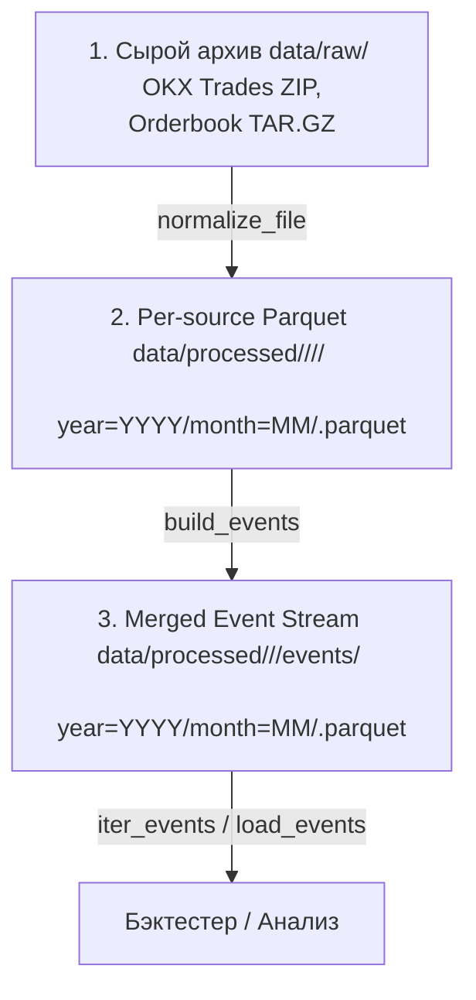

# Архитектура модуля Normalization & Storage

Модуль `src/normalizers` и `src/storage` отвечает за потоковую трансформацию разнородных сырых архивов бирж (ZIP/CSV, TAR.GZ/NDJSON) в единую унифицированную схему событий [`EVENT_SCHEMA`](file:///Users/kyle/main/py_files/backtest_strat/src/normalizers/schema.py), детерминированную сортировку по времени и источникам, и сохранение в партиционированный формат Parquet.

---

## 1. Концепция слоев данных (Data Layers)

Пайплайн нормализации разделен на три последовательных уровня:



1. **Raw (`data/raw/<exchange>/<symbol>/<data_type>/`):** Неизменяемые сжатые архивы, скачиваемые с биржи.
2. **Per-source Parquet (`data/processed/<exchange>/<symbol>/<data_type>/year=YYYY/month=MM/`):** Промежуточный нормализованный слой. Каждый исходный файл преобразуется в Parquet со схемой `EVENT_SCHEMA`. Это позволяет повторно использовать уже распарсенные данные без повторной распаковки тяжелых архивов.
3. **Unified Events (`data/processed/<exchange>/<symbol>/events/year=YYYY/month=MM/<YYYY-MM-DD>.parquet`):** Итоговый поток событий за полные сутки по шкале UTC `[00:00:00, 24:00:00)`. Сделки и стакан объединены и детерминированно отсортированы.

---

## 2. Схема событий (`EVENT_SCHEMA`)

Каждая строка в Parquet-файлах представляет собой одно атомарное рыночное событие:
- Сделка (`TRADE = 0`).
- Изменение отдельного ценового уровня в стакане (`BOOK_SNAPSHOT = 1`, `BOOK_UPDATE = 2`).

| Поле | Arrow Type | Описание |
| :--- | :--- | :--- |
| `ts` | `timestamp("ns", tz="UTC")` | Временная метка события в наносекундах UTC. |
| `event_type` | `int8` | Тип события: `0 = TRADE`, `1 = BOOK_SNAPSHOT`, `2 = BOOK_UPDATE`. |
| `side` | `int8` | Направление: `1 = BUY` (агрессор-покупатель для сделки / bid в стакане), `-1 = SELL` (агрессор-продавец / ask в стакане). |
| `price` | `float64` | Цена сделки или ценовой уровень стакана. |
| `size` | `float64` | Объем сделки или доступный объем на уровне (`0.0` означает удаление уровня в `BOOK_UPDATE`). |
| `num_orders` | `int32 (nullable)` | Количество ордеров на уровне (только для L2 orderbook; для сделок `null`). |
| `msg_id` | `int64` | `trade_id` для сделок; порядковый номер сообщения в исходном файле стакана. |
| `level` | `int16` | Индекс уровня внутри одного пакета стакана (`0..N-1`), `0` для сделок. |

---

## 3. Детерминированный порядок сортировки (`SORT_KEYS`)

Криптовалютные биржи (включая OKX) фиксируют события с миллисекундной точностью (`created_time[ms]`). На ликвидных инструментах в одну и ту же миллисекунду происходят десятки событий:
- В среднем за сутки происходит **~7 000+ совпадений** миллисекундных таймстемпов между сделками и обновлениями книги.

Для обеспечения 100% повторяемости бэктеста применяется строгий кортеж ключей сортировки [`SORT_KEYS`](file:///Users/kyle/main/py_files/backtest_strat/src/normalizers/schema.py#L40):

$$\text{SORT\_KEYS} = (\text{ts},\; \text{is\_book},\; \text{msg\_id},\; \text{level})$$

### Правило «Сделка раньше стакана»:
При равном значении `ts`, сделка (`is_book = False`) **всегда ставится раньше** обновления стакана (`is_book = True`).  
**Физический смысл:** Апдейт стакана в той же миллисекунде является следствием исполнения рыночного ордера. Сначала бэктестер должен учесть исполнение сделки, и только затем применить сдвиг ликвидности в книге заявок.

---

## 4. Специфика временных зон бирж (Выравнивание UTC+8 и UTC)

- **OKX Orderbook:** архивы нарезаны строго по календарным суткам UTC (`00:00:00 — 23:59:59.999 UTC`).
- **OKX Trades:** исторические архивы сделок формируются по часовому поясу Гонконга **UTC+8**:
  $$\text{Сутки файла } X = [X-1\text{ 16:00:00 UTC}, \; X\text{ 16:00:00 UTC})$$

### Покрытие UTC-дня:
Чтобы собрать полный день событий $D$ по UTC, требуются:
1. `orderbook` за день $D$ (UTC).
2. `trades` за день $D$ (покрывает интервал $00:00 - 16:00$ UTC).
3. `trades` за день $D+1$ (покрывает интервал $16:00 - 24:00$ UTC).

Если файл `trades` за день $D+1$ еще не скачан, метод `build_events` возвращает статус `StepStatus.INCOMPLETE` с четким описанием отсутствующих файлов.

---

## 5. Идемпотентность и атомарность записи

1. **Реестр манифеста ([`Manifest`](file:///Users/kyle/main/py_files/backtest_strat/src/storage/parquet.py)):**
   В каталоге инструмента хранится `_manifest.json`, в котором фиксируются:
   - Фингерпринт исходных файлов (имя + точный размер в байтах).
   - Список сгенерированных выходных файлов Parquet.
   Если размер файла не изменился и выходы существуют на диске, этап помечается как `SKIPPED`.
2. **Атомарная запись через `.part`:**
   Каждая партиция пишется во временный файл `<name>.part`. Переименование происходит только в методе `commit()`. В случае ошибки или прерывания процесса метод `abort()` удаляет все `.part` файлы.
3. **Межпроцессная блокировка (`file_lock`):**
   При запуске нормализации берется исключительная блокировка через `fcntl.flock` на файл `<processed>/<exchange>/<symbol>/.lock`. Это предотвращает гонки между фоновым cron и ручными задачами из Web UI.

---

## 6. Как применять события в бэктестере

```python
from datetime import date
from src.normalizers.schema import BOOK_SNAPSHOT, BOOK_UPDATE, BUY, SELL, TRADE
from src.storage.reader import iter_events

current_msg_id = None
pending_book_updates = []

for batch in iter_events("BTC-USDT", date(2024, 1, 1), date(2024, 1, 1)):
    for row in batch.to_pylist():
        etype = row["event_type"]

        if etype == TRADE:
            # Исполнение сделки
            # side: 1 (buyer aggressor), -1 (seller aggressor)
            on_trade(ts=row["ts"], price=row["price"], size=row["size"], side=row["side"])

        elif etype == BOOK_SNAPSHOT:
            # Полный срез стакана (каждую минуту у OKX):
            # Если это первый уровень нового сообщения — сначала очищаем локальную книгу!
            if row["level"] == 0:
                clear_local_orderbook()
            set_level(side=row["side"], price=row["price"], size=row["size"], orders=row["num_orders"])

        elif etype == BOOK_UPDATE:
            # Инкрементальный дифф:
            if row["size"] == 0.0:
                delete_level(side=row["side"], price=row["price"])
            else:
                set_level(side=row["side"], price=row["price"], size=row["size"], orders=row["num_orders"])
```

---

## 7. Чтение данных: `iter_events` и `load_events`

```python
from datetime import date
from src.storage.reader import iter_events, load_events

# Потоковое чтение батчами по 100_000 строк (минимальный расход памяти)
for batch in iter_events("BTC-USDT", date(2024, 1, 1), date(2024, 1, 7), batch_size=100_000):
    process_batch(batch)

# Загрузка всего интервала в единую таблицу PyArrow (для ad-hoc анализа)
table = load_events("BTC-USDT", date(2024, 1, 1), date(2024, 1, 1), columns=["ts", "price", "size"])
df = table.to_pandas()
```
