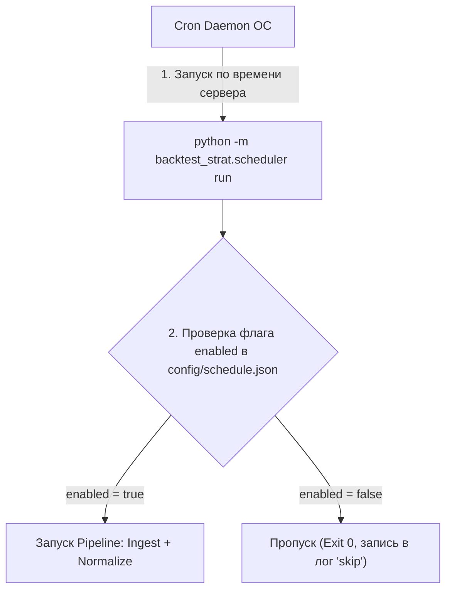

# Эксплуатация и мониторинг: Планировщик и Логирование

В данном документе описаны архитектура регулярного ночного сбора данных, централизованная система логирования и управление расписанием.

---

## 1. Схема двух независимых выключателей

Пайплайн использует двухуровневую систему управления ночным запуском:



1. **Системный выключатель (`crontab`):**
   - Управляет тем, запускается ли процесс планировщика вообще.
   - Устанавливается на сервере вручную администратором командой `python -m backtest_strat.scheduler install`.
   - В целях безопасности веб-интерфейс (Streamlit UI) и HTTP API **намеренно не имеют прав** редактировать системный crontab пользователя.
2. **Логический выключатель (`enabled` в `config/schedule.json`):**
   - Управляет тем, выполняет ли запущенный планировщик реальную загрузку.
   - Если `enabled == false`, запуск немедленно завершается с кодом `0` и информационным сообщением в логе (`"Расписание выключено... — пропуск"`).
   - Этот флаг можно безопасно переключать как через CLI (`enable` / `disable`), так и через переключатель во вкладке **Расписание** в веб-дашборде.

---

## 2. Команды планировщика (CLI)

```bash
# Проверить статус: включен ли флаг, установлена ли строка в crontab, будет ли выполняться запуск
python -m backtest_strat.scheduler status

# Включить / выключить логический флаг (меняет config/schedule.json)
python -m backtest_strat.scheduler enable
python -m backtest_strat.scheduler disable

# Установить / обновить строку в системном crontab (чужие строки не затрагиваются)
python -m backtest_strat.scheduler install --time 02:30

# Удалить строку проекта из crontab
python -m backtest_strat.scheduler uninstall

# Показать сгенерированную строку cron без изменения crontab
python -m backtest_strat.scheduler show-cron

# Ручной запуск ночной процедуры (с ключом --force-run даже если enabled=false)
python -m backtest_strat.scheduler run --force-run
```

### Как включить планировщик на новом сервере:
1. Задать желаемое локальное время и установить запись в cron:
   ```bash
   python -m backtest_strat.scheduler install --time 02:30
   ```
2. Активировать логический флаг:
   ```bash
   python -m backtest_strat.scheduler enable
   ```
3. Проверить статус:
   ```bash
   python -m backtest_strat.scheduler status
   # will_run должен быть True
   ```

---

## 3. Lookback и выравнивание таймзон

В `config/schedule.json` по умолчанию задан параметр:
```json
"lookback_days": 3
```

Каждую ночь планировщик берет диапазон:
- $\text{end} = \text{вчера (UTC)}$.
- $\text{start} = \text{end} - (\text{lookback\_days} - 1)$.

### Зачем нужен `lookback_days > 1`:
1. **Самовосстановление:** Если сервер был выключен или на бирже произошел временный сбой, пропущенные дни автоматически скачаются и нормализуются при следующем запуске.
2. **Идемпотентность:** Благодаря манифестам и проверке существующих файлов уже готовые дни пропускаются (`SKIPPED`) за доли секунды без повторных HTTP-запросов.
3. **Задержка сделок OKX (UTC+8):** Сделки на OKX публикуются по гонконгскому времени (UTC+8). Сборка событий за день $D$ требует архивов сделок за день $D$ и $D+1$. Поэтому события за день $D$ собираются только после появления архивов за день $D+1$.

---

## 4. Централизованное логирование

Все подсистемы (CLI, ночной cron, FastAPI сервер, Streamlit UI) пишут логи в общий каталог `logs/` в едином формате:

```text
2026-10-11 02:30:00,123 [INFO] [cron] backtest_strat.scheduler: Ночной запуск: okx ['BTC-USDT'] 2026-10-08..2026-10-10
2026-10-11 02:30:15,456 [INFO] [cron] backtest_strat.pipeline: ingest BTC-USDT/trades: downloaded=1, skipped=2, missing=0, failed=0
2026-10-11 10:15:20,789 [WARNING] [ui] backtest_strat.api.app: Отклонена задача: end раньше start
```

### Особенности реализации:
* **Суточные файлы:** Логи пишутся в `pipeline-YYYY-MM-DD.log` (по UTC).
* **Бесконфликтная ротация:** Обработчик [`DailyFileHandler`](../backtest_strat/utils/logging_setup.py#L36) переключает имя файла на лету при наступлении новых суток UTC. Файлы не переименовываются, что исключает гонки при параллельной записи из нескольких процессов.
* **Метка источника:** Каждый процесс передает метку `[source]` (`cron`, `cli`, `api`, `ui`). Запросы от Web UI передают заголовок `X-Client: ui`, автоматически логируясь с меткой `[ui]`.
* **Автоматическая очистка (retention):** При каждом вызове `setup_logging` файлы старше `PIPELINE_LOG_RETENTION_DAYS` (по умолчанию 30 дней) автоматически удаляются.
* **Склейка Traceback:** Метод `read_logs` агрегирует многострочные стеки ошибок Python в единый объект записи лога.

---

## 5. Переменные окружения (Environment Variables)

| Переменная | По умолчанию | Описание |
| :--- | :--- | :--- |
| `PIPELINE_LOG_DIR` | `logs` | Каталог для сохранения суточных файлов логов. |
| `PIPELINE_LOG_RETENTION_DAYS` | `30` | Количество дней хранения логов до автоочистки. |
| `PIPELINE_SCHEDULE_CONFIG` | `config/schedule.json` | Путь к JSON-файлу конфигурации расписания. |
| `PIPELINE_CRONTAB_BIN` | `crontab` | Путь к бинарному файлу crontab в ОС (переопределяется в тестах). |

---

## 6. Вкладки управления в Web UI

1. **Вкладка «Расписание»:**
   - Отображает текущее состояние планировщика (флаг enabled, наличие строки в crontab, статус ночного запуска).
   - Позволяет изменить время запуска, перечень инструментов и глубину `lookback_days`.
2. **Вкладка «Логи»:**
   - Поиск по тексту сообщений и именам логгеров.
   - Фильтрация по уровням важности (`INFO`, `WARNING`, `ERROR`).
   - Фильтрация по источнику (`cron`, `cli`, `api`, `ui`).
   - Выбор интервала в днях (от 1 до 30).
